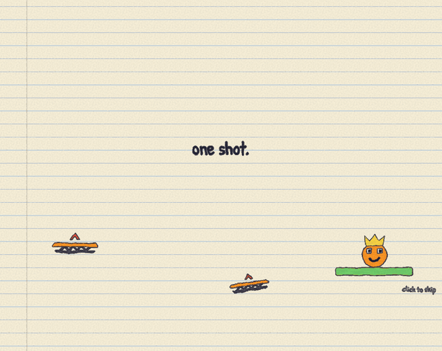

# Haven

A slingshot bounce platformer drawn like a doodle in a school notebook. You can't walk and you can't jump. You get one shot per try, and after that the bounce pads and walls decide where you end up.

Made with Godot 4.7.

## How to play

Hold the left mouse button, drag away from where you want to go, and let go. The further you pull, the harder the launch. That is your only input for the whole attempt.

- Reach the spinning star to finish the level.
- Bounce pads fire you in the direction their arrow points.
- Teal walls bounce you back at full speed. Gray walls take some of your speed away.
- Pink paper walls rip the first time you hit them and bounce you back. After that they are gone.
- Purple pads only fire once.
- Some pads slide back and forth, so when you launch matters.
- Spikes restart the level. So does falling off the page, or coming to a stop anywhere that isn't the goal.
- Press R to retry straight away, or Esc to go back to the menu.

There are six levels: a warm-up, Bank Shot, The Climb, Paper Walls, Moving Day and The Last Page. Level 3 also hides a way into a secret one, if you look closely at the page.

On the start screen, any click or key skips the intro, and Enter starts the game. Levels you have reached show up as page numbers under the Play button, and that progress is saved.

## Running it from source

1. Install [Godot 4.7](https://godotengine.org/download) (standard build, no .NET needed).
2. Clone this repo.
3. Open Godot, choose Import, and pick `project.godot`.
4. Press F5.

## Exporting for itch.io

The project uses the Compatibility renderer, so it can be exported to web.

1. In Godot, open Project > Export, add a Web preset, and install the export templates if asked.
2. Export to a folder with the file named `index.html`.
3. Zip the contents of that folder and upload the zip to itch.io with "This file will be played in the browser" ticked.

## Project layout

Everything sits in the project root.

| File | What it is |
| --- | --- |
| `start_screen.tscn`, `start_screen.gd` | Main scene: title, intro animation, Play and Quit |
| `level.tscn`, `level_2.tscn` ... `level_6.tscn` | The six levels, in order |
| `secret_level.tscn`, `secret_portal.tscn` | The hidden level and the way into it |
| `ending.tscn`, `ending.gd` | Ending screen after level 6 |
| `goat_win.tscn`, `goat_win.gd` | Win screen for the hidden level |
| `game.gd` | Autoload: level order, save file, shot counter, sounds, HUD, scene fades |
| `player.tscn`, `player.gd` | The ball: aiming, launching, restart rules |
| `bounce_pad.tscn`, `spikes.tscn`, `goal.tscn`, `paper_wall.tscn` | Pieces you drag into a level |
| `mover.gd` | Slides its parent node back and forth (moving pads) |
| `press/` | Cover GIF and screenshots for the itch.io page |
| `background.tscn`, `sketch.gdshader` | Paper background and the full-screen shader that draws the pen outlines and ruled lines |
| `trail.tscn`, `trail.gd` | The speed line behind the ball |

## Making a level

1. Duplicate an existing level scene and rearrange it.
2. Drag in `bounce_pad.tscn`, `spikes.tscn`, `paper_wall.tscn` and `goal.tscn` as needed. Rotate a pad to aim it; its `Strength` property sets the launch speed, and `One Use` makes it a purple single-use pad. To make something move, add a plain Node under it with `mover.gd` attached.
3. For a bouncy wall, give the wall a PhysicsMaterial with `bounce` set (1.0 for teal walls, 0.6 for gray).
4. Add the scene path to the `LEVELS` list at the top of `game.gd`. Levels play in that order.

Use flat colours for new art. The sketch shader adds the hand-drawn look on top.

## Credits

The font is [Patrick Hand](https://fonts.google.com/specimen/Patrick+Hand) by Patrick Wagesreiter, used under the SIL Open Font License (`patrick_hand_license.txt`). The sound effects are generated in code.

`CONVENTIONS.md` has more detailed notes on how the scenes and scripts fit together.
